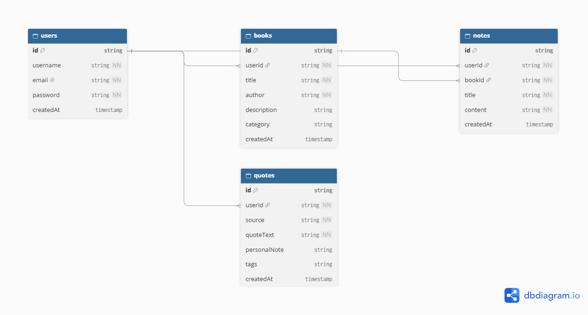

# 🚀 Growth OS - Engineering Journey & Dev Log

Welcome to my build log! This document tracks my daily evolution, architectural decisions, and milestones as I design and build **Growth OS**—a minimalist productivity application—from scratch over 2 months.

---

## 📅 Phase 0: Foundations & Architecture Planning
**Goal:** Define the product vision, select a high-performance tech stack, and design a production-grade NoSQL database schema before writing code.

### 🛠️ The Tech Stack Selection
- **Frontend:** React, React Router, Tailwind CSS, TypeScript.
- **Backend:** Node.js, Express.js (Modular REST API structure).
- **Database:** MongoDB & Mongoose ODM (Document-based relational mapping).
- **Authentication:** JSON Web Tokens (JWT) & Bcrypt.js for secure, stateless auth.

### 🗄️ Database Schema & Data Modeling
Instead of nesting data randomly, I structured a normalized NoSQL architecture using MongoDB references (`ObjectId`) to establish clean **One-to-Many relationships** (e.g., A User has many Books, and a Book has many Notes).

#### Core Collections:
1. **Users:** Manages authentication (`email`, hashed `password`, `createdAt`).
2. **Books/Resources:** Stores learning sources owned by a specific user (`userId`, `title`, `author`, `category`).
3. **Notes:** Tied directly to a book and user (`userId`, `bookId`, `content`), allowing users to click a book and fetch its specific notes dynamically.
4. **Quotes:** Tracks memorable insights with personal reflections and tags.

---

## ✍️ Daily Log

### [Day 1 - Setup & Schema Design]
- **What I Built:** 
  - Defined the core data structures for the Authentication, Library Notes, and Quotes modules.
  - Resolved the architectural flow for how clicking a book fetches its corresponding notes via `bookId` routing and backend API queries (`GET /api/notes/:bookId`).
- **Key Learnings:** Learned why MongoDB referencing (`ObjectId`) is superior to embedded arrays for scalable, independent note management.
- **Next Steps:** Initialize the Node.js/Express backend, configure environment variables, and write the Mongoose `User` and `Book` models.

---
